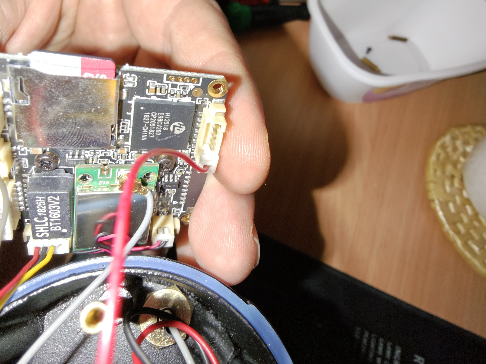

# Bedee 2 MP IP camera: hardware, firmware backup and OpenIPC

An old Bedee camera turned into a small firmware archaeology project: identify the board, get past a password-protected serial console without needing its password, back up the entire flash, install OpenIPC, and recover working infrared night vision.

The result is a working **Hi3518EV200 / SC2235 camera running OpenIPC**, with Ethernet, 1080p video, a working IR-cut filter, and automatic day/night switching from the original photocell. The complete flash was backed up twice before installation. A normal reboot and a full night/day cycle were verified after the final changes.

These notes describe **one physical unit tested on 17 November 2026**. A Bedee badge, a similar enclosure, or a matching HTTP banner does not establish that another camera has the same board.

!!! warning "Board-specific research, not a generic upgrade recipe"
    The flash offsets, DDR configuration and register addresses below belong to this board and the recorded image versions. Flashing replaces the stock bootloader and configuration. Obtain and verify your own full backup and recovery path before writing anything. The stock restoration procedure is prepared but has **not** been exercised end to end.

## Product identity and verified hardware

The stock camera reported model **`C6F0SgZ3N0P6L2`** and firmware **`V11.1.34.5.3-20180829`**. Its services exposed HiChip/Hipcam RTSP on TCP 554, Mongoose HTTP on TCP 80, and ONVIF on TCP 8080. RTSP paths `/11` and `/12` worked.

Opening the housing, reading the boot log, examining the stock dump, and finally booting OpenIPC established the useful hardware identity:

- **SoC:** HiSilicon Hi3518EV200. The package marking reads `Hi3518` / `ERBCV200`.
- **Image sensor:** SmartSens **SC2235**, confirmed by the stock software and successful OpenIPC sensor initialization.
- **RAM:** **64 MiB, DDR2**. The compared DDR initialization table includes `0x20111050 = 0x15`.
- **Flash:** **XM25QH64A**, **8 MiB SPI NOR**, reported JEDEC ID `20 70 17`.
- **PCB:** the visible silkscreen includes `18EV2_2235AF`. The complete revision suffix is not confidently readable in the photograph.
- **Networking:** wired Ethernet and an **MT7601U** Wi-Fi module. The OpenIPC image contains the Wi-Fi driver and firmware; association was not tested during this work.
- **Other hardware:** microSD slot, infrared LED ring with a separate visible photocell and a three-wire connection, and a mechanically actuated IR-cut filter.




The microSD controller recognized a 64 GB card during recovery. That is evidence of card detection, not a test of recording, filesystem reliability, or supported maximum capacity.

### OpenIPC support versus a vendor-compatible upgrade package

OpenIPC has a [Hi3518EV200 target](https://openipc.org/cameras/vendors/hisilicon/socs/hi3518ev200), and the inspected image contained `libsns_sc2235.so`, an SC2235 profile and loader support. On this unit that became stronger evidence when the sensor initialized and produced video.

[Coupler](https://github.com/OpenIPC/coupler) lists CamHi/HiChip/Xin, but its vendor-family listing did not establish a matching transition image for this exact Bedee model, stock firmware and board. No Coupler package was flashed or validated here. The successful route was **ROM UART recovery followed by a manually verified raw NOR image**.

OpenIPC also includes vendor components. The running streamer, Majestic, presented a licence agreement during initial setup; the owner accepted it personally and chose a new root password. Installing OpenIPC does not make every component an unrestricted open-source replacement.

## UART access

The adapter was an **FTDI TTL-232R-3V3**, enumerating on Linux as `0403:6001` (`FT232 Serial (UART) IC`). The working serial format was **115200 baud, 8 data bits, no parity, one stop bit, no flow control**.

For this adapter:

```text
black   -> camera ground
yellow  -> camera TX  (adapter RX)
orange  -> camera RX  (adapter TX)
red     -> DISCONNECTED
```

The camera kept its own power supply. The adapter's 3.3 V logic label is not permission to connect its power lead to the board.

On this board, the **second pad counting from the microSD-slot end of the four-pad row** had continuity to ground. The remaining pads all initially measured about 3.3 V, which did not identify their functions. Idle UART lines can be high. This investigation did not retain a sufficiently certain complete pad-order diagram to publish one.

Early serial output was unreliable until the wires, pads and connectors were properly soldered. Stable text followed. A multimeter finding alone was not a substitute for a sound connection.

The Linux listening command was:

```sh
sudo picocom -b 115200 -d 8 -p n -f n --stopbits 1 \
  --logfile camera-boot.log /dev/ttyUSB0
```

Only one program should own the serial device at a time. Stop `picocom` before using the recovery uploader. Its terminal can display the later Linux console, but the RAM-upload operation itself is not something to rerun for every normal camera boot.

### What the stock console revealed

The stock bootloader identified itself as:

```text
U-Boot 2010.06 (Nov 30 2017 - 15:05:15)
SPI Nor(cs 0) ID: 0x20 0x70 0x17
Block:64KB Chip:8MB Name:"xm25qh64a"
SPI Nor total size: 8MB
```

Interrupting autoboot produced an **U-Boot password prompt**. Letting Linux boot produced a separate `(none) login:` prompt. Working web credentials did not establish a usable serial root login. A stock shell password was not recovered; neither a successful Telnet shell nor an exploit-based shell is a prerequisite for the method below.

## A recovery path before a flash write

The useful alternative to buying an SPI programmer was [OpenIPC defib](https://github.com/OpenIPC/defib), using the HiSilicon ROM download protocol to load a recovery bootloader into RAM. The session recorded defib revision `5167b2a8669a604ce546adb1bffc6da20cf5c1a3`.

From the private recovery kit directory on the Linux host:

```sh
sudo ../camera-recovery-env/bin/defib burn \
  --chip hi3518ev200 \
  --file recovery/u-boot-hi3518ev200-recovery.bin \
  --port /dev/ttyUSB0 \
  --break --terminal
```

The camera was powered on when the uploader waited for it. The transfer sent the DDR step, SPL and U-Boot, then reached `OpenIPC #`.

**For this command and recovery file, `burn` loaded RAM; it did not program the SPI flash.** Do not generalize that statement to defib's other commands. In particular, automatic installation/restoration operations have different write behavior.

The working recovery binary was 127,459 bytes and displayed **U-Boot 2010.06, built 4 October 2026**. The shared version string does not mean it is identical to the stock November 2017 bootloader.

### Ethernet: configure it before the first network command

The lab used these private addresses:

```text
camera in recovery: 192.168.2.113
Linux TFTP host:    192.168.2.115/24 on br0
camera in OpenIPC:  192.168.2.119 after DHCP
```

On the host, `ip -4 route get 192.168.2.113` confirmed the correct interface and source address.

In a **fresh** RAM recovery session, configure the PHY before the first `ping` or TFTP command:

```text
setenv mdio_intf rmii
setenv phyaddru 0
setenv phyaddrd 1
setenv ethaddr <YOUR-CAMERA-ETHERNET-MAC>
setenv ipaddr 192.168.2.113
setenv serverip 192.168.2.115
setenv netmask 255.255.255.0
ping 192.168.2.115
```

Replace the MAC placeholder with the unit's own wired MAC. The successful result included:

```text
eth0 : phy status change : LINK=UP : DUPLEX=FULL : SPEED=100M
host 192.168.2.115 is alive
```

An earlier attempt reported `PHY not link`. Changing settings after the driver had already registered MDIO devices produced repeated `No such device` and `PHY_PHYIDR1 read failed` messages. Starting recovery again and setting RMII / PHY 0 and 1 **before the first network operation** fixed it.

Read-only `mii` inspection had reported devices `'0:1'` and `'1:2'`, and a PHY with OUI `0x90c3`, model `0x05`, revision `0x04`. This did not justify cycling through arbitrary PHY addresses.

!!! danger "Do not save the recovery environment over stock firmware"
    The temporary OpenIPC bootloader saves its environment at **`0x40000`**. The stock firmware's kernel starts at **`0x40000`**. Running `saveenv` while retaining stock firmware overwrites part of that kernel. All networking changes above belong in RAM only.

## Backing up the whole SPI NOR

The recovery U-Boot could read all 8 MiB and **upload** the buffer to the host over TFTP. A writable TFTP server was running on the host; an upload needs write permission and a working UDP return path, not just the ability to download files.

At the bootloader prompt:

```text
sf probe 0
mw.b 0x82000000 0xff 0x800000
sf read 0x82000000 0x0 0x800000
crc32 0x82000000 0x800000
tftp 0x82000000 bedee-stock-A.bin 0x800000
```

The CRC was **`dc96fe13`**, and the transfer reported **8.000 MB upload ok**. The whole sequence, including clearing RAM and reading flash again, was repeated into `bedee-stock-B.bin`.

This bootloader's TFTP convention matters:

```text
tftp ADDRESS FILENAME         -> download from server into RAM
tftp ADDRESS FILENAME LENGTH  -> upload RAM to server
```

Both host files were verified independently:

```python
from pathlib import Path
import hashlib
import zlib

copies = []
for name in ("bedee-stock-A.bin", "bedee-stock-B.bin"):
    data = (Path("camera-backup") / name).read_bytes()
    copies.append(data)
    print(name, "bytes:", len(data),
          "CRC32:", f"{zlib.crc32(data) & 0xffffffff:08x}",
          "SHA256:", hashlib.sha256(data).hexdigest())
print("IDENTICAL:", copies[0] == copies[1])
```

The result for **both** files was:

```text
bytes: 8388608
CRC32: dc96fe13
SHA256: 9003857fc480dad37dfb7f44e0a02a6d389e3fd2244e3247c8458f3046c77637
IDENTICAL: True
```

These hashes identify this particular captured image. Another camera, or another normal stock boot which writes settings, can legitimately produce different hashes.

The dump includes the bootloader, environment, kernel, filesystems and configuration. It can contain passwords and device identifiers. **The dump and the private full recovery kit are deliberately not included in this documentation repository.**

## Choosing and constructing the OpenIPC image

The tested combination was:

- **Hi3518EV200 fixed-partition NOR Lite**, firmware asset published 17 November 2026.
- **Legacy universal U-Boot**, asset published 4 October 2026, for installation in flash.
- The matching **recovery U-Boot**, for ROM/UART loading into RAM.

The firmware booted Linux **4.9.37**, identified the sensor as SC2235, and presented OpenIPC **`master+03d1125`, `2.6.11.17-lite`**. The video preview reported **H.264, 1920×1080, 20 fps**.

### Pin the files, not the word “latest”

The upstream [firmware release](https://github.com/OpenIPC/firmware/releases/tag/latest) is mutable. The actual input file hashes were:

```text
openipc.hi3518ev200-nor-lite.tgz
  SHA256 4cb90cfef7a75468e59bd26b2e9ffeaf50e7eb1da27054890bffe124c060857a
u-boot-hi3518ev200-universal.bin
  SHA256 1eb2b173e1f655fab77ee154886acd5076bd0a2b0df2212659daba73d7b830d3
u-boot-hi3518ev200-recovery.bin
  SHA256 f39203ddd7b92f8a7e74845af7ef85417fd820caa295731eac91fa8e03d99b88
```

The downloaded assets matched the GitHub asset digests. The archive's component MD5 checks and the kernel's uImage header/data CRCs also passed. The kernel occupied **1,841,249 bytes** of its 2 MiB slot; rootfs occupied **5,070,848 bytes** of its 5 MiB slot.

The stock and universal bootloader DDR tables, byte range **`0x40..0x43f` inclusive**, were identical. The recovery and universal files decompressed to the same U-Boot payload, but their compressed payload positions differed:

```text
recovery:  0x2c00  (inside the ROM's 0x3b00 SRAM window)
universal: 0x4400  (use for flash, not the ROM UART download)
```

This ruled out casually substituting a DDR3 bootloader, the newer `2022.10` NOR bootloader, a NAND image, or a different layout. Matching the DDR table was a preflight check; the eventual successful hardware boot was the confirmation.

### Stock layout

All offsets and lengths here are hexadecimal:

```text
name    start       length
boot    0x000000    0x040000  (stock environment at 0x030000)
kernel  0x040000    0x150000
rootfs  0x190000    0x260000
ipc     0x3f0000    0x290000
conf    0x680000    0x180000
```

### Installed OpenIPC layout

```text
name         start       length
boot         0x000000    0x040000
env          0x040000    0x010000
kernel       0x050000    0x200000
rootfs       0x250000    0x500000
rootfs_data  0x750000    0x0b0000  (704 KiB writable overlay)
```

The private candidate was assembled offline as a full **8 MiB raw NOR image**. The universal bootloader, kernel and rootfs were retained unchanged. The default bootloader environment was extended with this board's sensor, memory, networking and original MAC, serialized into a 64 KiB CRC-protected environment sector. Padding and the initial overlay were `0xff`.

The relevant board settings were:

```text
soc=hi3518ev200
sensor=sc2235
totalmem=64M
osmem=32M
mdio_intf=rmii
phyaddru=0
phyaddrd=1
netmode=eth
netaddr_fallback=192.168.2.113
```

`osmem=32M` leaves the other half of the physical RAM for the media subsystem. The release's default boot commands and helper variables were retained.

The [offline image builder](assets/bedee-openipc/assemble-image.py) records this process using the pinned inputs. It requires a caller-supplied stock backup and the unit's actual wired MAC, performs no downloads, and never contacts a camera. Keep its output outside a public repository. Its defaults reproduce the lab addresses; a different MAC or environment changes the final checksums.

```sh
python3 assemble-image.py \
  --stock /private/camera-backup/bedee-stock-A.bin \
  --firmware /private/downloads/openipc.hi3518ev200-nor-lite.tgz \
  --universal /private/downloads/u-boot-hi3518ev200-universal.bin \
  --recovery /private/downloads/u-boot-hi3518ev200-recovery.bin \
  --mac YOUR-CAMERA-ETHERNET-MAC \
  --out /private/bedee-openipc-image
```

The original unit-specific candidate's fingerprints were:

```text
full size:             8388608 bytes
full CRC32:            892a4b0a
full SHA256:           9253d8ebb644b5677a3e524bc9c7797f666af5fe27b7075ab7dc0a0a220f6e66
non-boot area CRC32:   bee8ead0  (offset 0x40000, length 0x7c0000)
```

This is a raw flash image, **not** a package for the stock web updater. The camera-specific candidate itself is not distributed here.

## The actual flash session

Before the write phase, the local kit verifier passed, the host route was checked, `/dev/ttyUSB0` existed, the recovery bootloader reported 64 MiB RAM and 8 MiB NOR, and another whole-flash read still matched the stock CRC.

The host served the kit's TFTP directory. For example, with the existing `tftpy` environment:

```sh
sudo /path/to/camera-recovery-env/bin/python -u - <<'PY'
from pathlib import Path
import tftpy
tftpy.TftpServer(str(Path('tftp').resolve())).listen('192.168.2.115', 69)
PY
```

The candidate was downloaded to RAM and checked **before** erasing anything:

```text
sf probe 0
tftp 0x82000000 bedee-openipc-lite-8m-candidate.bin
printenv filesize
crc32 0x82000000 0x800000
```

The actual transfer was **8,388,608 bytes**, `filesize=800000`, CRC **`892a4b0a`**.

!!! danger "Destructive commands: historical record for the verified candidate"
    The following writes were executed on this camera. Do not paste them for a different image based only on a similar filename. Use the size and checksums calculated for the exact image in RAM, maintain stable power, and stop at any readback mismatch.

The non-boot area was written and read back first:

```text
sf erase 0x40000 0x7c0000
sf write 0x82040000 0x40000 0x7c0000
sf read 0x82040000 0x40000 0x7c0000
crc32 0x82040000 0x7c0000
```

Its CRC matched **`bee8ead0`**. Only then was the first 256 KiB replaced:

```text
sf erase 0x0 0x40000
sf write 0x82000000 0x0 0x40000
sf read 0x82000000 0x0 0x800000
crc32 0x82000000 0x800000
```

The **entire flash readback** matched **`892a4b0a`**, and only then was `reset` issued. Reading back into the same RAM buffer was paired with comparing against the separately recorded expected CRC.

One mistake in the session deserves recording: `saveenv` was entered before the non-boot erase/write, and it wrote the sector at `0x40000`. The subsequent verified full candidate write replaced that sector. It caused no residual mismatch in this installation, but it is exactly why `saveenv` must not be part of stock-preserving recovery or rollback instructions.

OpenIPC booted, the owner completed first-run setup, and the board was reassembled after reconnecting the Wi-Fi antenna and IR ring. The address changed from `.113` to `.119` through DHCP. The bootloader's temporary recovery IP was not proof of the later Linux address.

The initial whole-image CRC is not expected to stay unchanged once Linux starts writing the overlay.

## A booting camera with an almost black image

There was recognizable movement, but stationary objects could become almost completely black even with the room light on and the lens uncovered. A mechanical click alone did not prove that the filter or exposure was correct.

With the default slow-shutter setting, exposure reached about **125 ms**, with analog gain around **62×** and additional ISP gain. The working change was:

```yaml
isp:
  slowShutter: disabled
```

In the tested UI this was **Off · keep the frame rate**. The image returned to normal, exposure settled around **33.2 ms**, and a reboot preserved the improvement. The temporary shadow-priority exposure experiment was reverted; normal automatic metering remained enabled.

This is a verified workaround on this driver/board combination. The exact underlying long-exposure fault was not established. Changing GPIOs or repeatedly moving the IR-cut filter was not the solution to this particular darkness problem.

## Recovering the stock IR-cut and lamp wiring

The stock dump contained an ARM `ipc_server` with exported function names, plus `ircut.ko`, `rled.ko`, `light.ko`, `relay.ko` and `saradc.ko`. Static inspection of those exact files provided a better starting point than a GPIO assignment borrowed from a different camera.

### The click is an IR-cut actuator

The stock call chain established:

```text
HI_IRCut_Switch(1) -> colour/day
HI_IRCut_Switch(0) -> monochrome/night

day:   ioctl 0 high -> wait 300000 us -> ioctl 0 low -> GPIO0_1
night: ioctl 1 high -> wait 300000 us -> ioctl 1 low -> GPIO0_2
```

Thus **global GPIO 1 moves to day**, and **global GPIO 2 moves to night**. These are the two drive directions of the IR-cut mechanism. The noise was not evidence of two relays, nor evidence that the clicking part supplied LED power.

The stock IR-cut module clears the low two mux bits at `0x200f0074` and `0x200f0078`; the observed values were already zero. Brief manual pulses were used during diagnosis, not sustained coil power.

The correct mapping in the tested Majestic schema was:

```yaml
nightMode:
  irCutPin1: 2  # opening/night
  irCutPin2: 1  # closing/day
```

An earlier opening/closing assignment was reversed. The recovered stock code settled the direction; the final full cycle confirmed it physically.

### The infrared lamp has a separate control

`HI_Infra_Switch` opens `/dev/rled`, with ioctl command 1 and argument 1 for on / 0 for off. `rled.ko` maps this to **GPIO7_7**, global **GPIO 63**, active high. Its stock mux setup sets bit 0 at `0x200f00fc`.

```yaml
nightMode:
  backlightPin: 63
  backlightInvert: false
```

The other stock modules had different purposes: `light.ko` touched GPIO 9 and 64, while `relay.ko` used GPIO 53. Their names were not a reason to drive those pins during IR diagnosis.

The ring visibly glowed when shaded, even during earlier manual-mode testing. That observation alone did not establish every part of the ring's local circuitry or prove that software could force illumination in bright ambient light. The later integrated night-vision test is the operational result that matters.

## Why native automatic night mode did not return to day

The first automatic configuration used the image's exposure/gain, enabled monochrome at night, and moved the filter and lamp together. It entered night mode and produced a night-vision image. Turning the room light back on and waiting 90 seconds did **not** restore colour.

The running camera reported:

```text
isp_again                 63488   # 62 * 1024
night_auto_gain_milli      62000
night_enabled             1
night_transitions_day_total 0
```

The actual `/api/v1/config.schema.json` allowed `autoDayGain` only from **1 to 16**, with a default of 2. The lit scene was still using about **62× analog gain**. No allowed day threshold could reach that reading in this scene.

This build also had **no native ADC photocell configuration keys**. Generic documentation mentioning `adcReadout` did not mean the installed Hi3518EV200 binary supported it. The [Majestic documentation](https://github.com/OpenIPC/wiki/blob/master/en/majestic-streamer.md) describes several decision sources; the running binary's schema and measurements determined which were usable here.

A generic CamHi GPIO table suggested investigating GPIO 48 as a light-sensor input. Reading its entire GPIO bank at `0x201a03fc` returned zero with the photocell exposed and covered. GPIO 48 was **not assigned or driven** on that basis.

## Reading the original analogue photocell

The stock application instead opens **`/dev/saradc`**. Its module revealed the initialization and conversion sequence for an **8-bit reading from channel 0**.

OpenIPC had no `/dev/*adc*` node. Before initialization, the observed registers were:

```text
0x200f015c = 0x00000000  # mux bit already clear
0x200f0160 = 0x00000000  # mux bit already clear
0x200b0000 = 0x000080ff
0x200b0010 = 0x00000000
0x200b000c = 0x00000000
```

The stock module's open routine clears bit 0 of each mux register, writes `0xff0201ff` to `0x200b0000`, and writes 1 to `0x200b0010`. Its read ioctl starts conversion with 15 at `0x200b001c`, waits **10 ms** (`msleep`, confirmed from the relocation), reads `0x200b000c`, acknowledges with 1 at `0x200b0018`, and returns the **low byte**.

The controlled shell test used a slightly longer 100 ms wait:

```sh
# Board-specific volatile register writes, recovered from the stock driver.
# Only after verifying the mux bits above are already clear:
devmem 0x200b0000 32 0xff0201ff
devmem 0x200b0010 32 1
adc_sample() {
    devmem 0x200b001c 32 15
    sleep 0.1
    devmem 0x200b000c 32
    devmem 0x200b0018 32 1
}
```

Covering only the small photocell by hand produced fluctuating values, so the decisive experiment used the actual room light:

```text
LIGHT ON:       0 0 0 0 0 0 0 0
LIGHT OFF:    255 255 255 255 255 255 255 255
LIGHT ON AGAIN: 17 0 0 0 0 0 0 0
```

That established a usable signal and its direction: **low means bright, high means dark**. The stock configuration supplied hysteresis thresholds of **30 for black-and-white to colour** and **90 for colour to black-and-white**.

The old Linux 3.4 stock module was not loaded into the OpenIPC 4.9 kernel. The workaround reproduces its small register sequence in userspace instead.

## Persistent photocell-driven day/night

The final configuration keeps Majestic responsible for the actual filter, lamp and image profile, while a small shell service decides *when* to request day or night.

```yaml
isp:
  slowShutter: disabled
nightMode:
  lightMonitor: false
  irCutPin1: 2
  irCutPin2: 1
  backlightPin: 63
  backlightInvert: false
  irCut: auto
  backlight: auto
  colorToGray: true
```

This is a relevant-settings fragment, **not a replacement for the entire configuration file**. `irCut` and `backlight` follow the requested night state; `lightMonitor: false` disables the competing native decision loop.

Local API checks succeeded without putting a password in a command or script:

```sh
curl -fsS -H 'Content-Type: application/json' \
  --data '{"nightMode":{"lightMonitor":false}}' \
  http://127.0.0.1/api/v1/config
curl -fsS http://127.0.0.1/night/off  # returned 0; click and colour confirmed
curl -fsS http://127.0.0.1/night/on   # returned 1 during the night test
```

No global authentication setting was weakened. These requests were made from the camera itself to loopback.

### Downloadable service

- [bedee-photocell.sh](assets/bedee-openipc/bedee-photocell.sh) → `/etc/bedee-photocell.sh`
- [S96bedee-photocell](assets/bedee-openipc/S96bedee-photocell) → `/etc/init.d/S96bedee-photocell`
- [Offline behavior checks](assets/bedee-openipc/test-photocell.sh), for reviewing the controller without camera access.

The controller uses the measured 0–255 reading and stock thresholds, with **15 continuous seconds at or above 90 before night**, and **60 continuous seconds at or below 30 before day**. Intermediate readings reset the countdown and retain the current mode. Timing uses monotonic uptime.

It checks the ADC mux without changing it, saves/restores the ADC control words, takes a single-instance lock, and calls `/night/on` or `/night/off`. It does not repeatedly save YAML or write firmware partitions. If the API temporarily disappears, it holds the current mode and restarts the delay after recovery. An ADC read failure or a competing native automatic source stops the service.

The installed file hashes were:

```text
bedee-photocell.sh
  b342a93d8892dff9f6aa0090fb52b32bcf81be1bf72cd4e4d04c201c3d13b252
S96bedee-photocell
  71cf9495464550e6be177ea83d0dc6dff92a7d53b80bb7ccb9888e508f351c58
```

For a clean installation, copy the two files to `/tmp` on the camera first. Keep Unix LF line endings; the companion directory's Git attributes enforce them on checkout. Legacy `scp -O` can be needed when the camera has no SFTP subsystem. Stop any temporary test loop, apply the settings above, and inspect the files before installing:

```sh
(
    set -e
    sh -n /tmp/bedee-photocell.sh
    sh -n /tmp/S96bedee-photocell
    test ! -e /etc/bedee-photocell.sh
    test ! -e /etc/init.d/S96bedee-photocell
    test ! -e /etc/bedee-photocell.disabled
    cp /tmp/bedee-photocell.sh /etc/bedee-photocell.sh
    cp /tmp/S96bedee-photocell /etc/init.d/S96bedee-photocell
    chmod 755 /etc/bedee-photocell.sh /etc/init.d/S96bedee-photocell
    /etc/init.d/S96bedee-photocell start
    /etc/init.d/S96bedee-photocell status
    sync
)
```

The existing boot sequence executes `S??*` scripts in order, so S96 runs after S95majestic. Startup can precede Majestic's API becoming ready; the controller handles that delay.

!!! note "The WebUI reports the native decision source as manual"
    `night_mode_source` remains **0** because the external photocell service makes the decisions. Automatic behavior is still active. Leave the WebUI's gain-based automatic monitor **off** while this service runs.

### Validation and stopping it

Eight offline scenarios passed: day/night delays, a brief shadow, hysteresis resetting the timer, API outage recovery, a rejected request, a competing automatic source, and ADC failure. The mocks replaced hardware, API and time boundaries; they did not substitute for the camera test.

On the camera, both files passed shell syntax and SHA256 checks. After a normal reboot, their hashes were unchanged and the service started automatically. Its log showed the initial API outage and recovery, then a night request at **ADC 255**. Metrics showed night, IR-cut and lamp all enabled. After turning the light on, the owner confirmed normal colour and metrics showed all three disabled. Both physical transitions were verified after reboot.

Useful checks:

```sh
/etc/init.d/S96bedee-photocell status
logread | grep bedee-photocell
curl -fsS http://127.0.0.1/metrics/night
```

To disable automatic switching and leave the camera in day mode:

```sh
/etc/init.d/S96bedee-photocell stop
touch /etc/bedee-photocell.disabled
curl -fsS http://127.0.0.1/night/off
```

Remove `/etc/bedee-photocell.disabled` and start the service to re-enable it. These are normal overlay files. A full reflash or overlay reset requires reinstalling the service and reapplying the exposure and pin settings; the original flashed candidate did not contain these later fixes.

## Returning to the stock firmware

The original dump remains the recovery authority. Re-enter the same **ROM UART recovery**, which does not depend on the flashed Linux system or the installed bootloader's console password. Configure RMII and PHY addresses before network access, then download the private stock image:

```text
sf probe 0
tftp 0x82000000 bedee-stock-8m.bin
printenv filesize
crc32 0x82000000 0x800000
```

For **this recorded backup**, require 8,388,608 bytes and **`dc96fe13`** before any erase. Use your independently verified values for a different backup.

!!! danger "Prepared restoration procedure — not hardware-tested end to end"
    The following would replace the entire installed system. The ROM recovery, flash reads, Ethernet transfer, and OpenIPC flash-write path worked. A complete stock restore and subsequent stock boot were not performed. Do not present that untested final step as a guaranteed recovery.

Restore the non-boot area first:

```text
sf erase 0x40000 0x7c0000
sf write 0x82040000 0x40000 0x7c0000
sf read 0x82040000 0x40000 0x7c0000
crc32 0x82040000 0x7c0000
```

The stock non-boot CRC must be **`28b590ad`**. Only after that matches, restore the original boot region and its environment:

```text
sf erase 0x0 0x40000
sf write 0x82000000 0x0 0x40000
sf read 0x82000000 0x0 0x800000
crc32 0x82000000 0x800000
```

Require full readback CRC **`dc96fe13`**. An optional TFTP upload of the full readback permits a host SHA256 comparison with the original before resetting. **Do not run `saveenv` after restoring stock**: the temporary bootloader would overwrite the restored kernel at `0x40000`. The original bootloader reads its own environment at `0x30000` after reset.

If the ROM recovery path cannot be re-established, an appropriate **3.3 V SPI programmer** is the remaining hardware fallback. None was needed or tested in this session. Power and in-circuit isolation would need checking before connecting one.

## What is verified, and what is still open

Verified on this physical camera:

- Serial communication and a working ROM-to-RAM recovery route.
- Two independent, byte-identical full flash backups, with matching target and host CRCs.
- Ethernet/TFTP in recovery and Ethernet networking under OpenIPC.
- The complete OpenIPC flash write and full-image readback, followed by a successful boot.
- SC2235 1080p video, the slow-shutter workaround, IR-cut direction, night vision and return to colour.
- Photocell-driven automatic operation and service startup after reboot.

Still unverified or incomplete:

- An end-to-end restoration and boot of the saved stock image.
- OpenIPC Wi-Fi association, audio, recording, buttons, and any motor/PTZ functions.
- Exact PCB revision suffix, a complete four-pad UART pinout, and the full schematic of the IR ring.
- A vendor-web-updater/Coupler transition for this exact model.
- Long-term stability, outdoor switching thresholds, and behavior under unusual IR reflections or changing ambient lighting.

## References and evidence

The board photographs, boot logs, two matching backups, extracted stock modules, release hashes, actual camera schema, and the final reboot/light-cycle test are the primary evidence for this unit. Private dumps, credentials, camera-specific environment files and raw flash images are intentionally excluded.

- [OpenIPC Hi3518EV200 target](https://openipc.org/cameras/vendors/hisilicon/socs/hi3518ev200)
- [OpenIPC firmware releases](https://github.com/OpenIPC/firmware/releases/tag/latest)
- [OpenIPC legacy bootloader source](https://github.com/OpenIPC/u-boot-hi3516cv200/tree/f769967e4dd56e727ee948e6102ac7544d722460)
- [OpenIPC defib](https://github.com/OpenIPC/defib)
- [OpenIPC Coupler](https://github.com/OpenIPC/coupler)
- [Supported sensor drivers](https://github.com/OpenIPC/wiki/blob/master/en/guide-supported-sensors.md)
- [Majestic configuration](https://github.com/OpenIPC/wiki/blob/master/en/majestic-config.md) and [streamer documentation](https://github.com/OpenIPC/wiki/blob/master/en/majestic-streamer.md)
