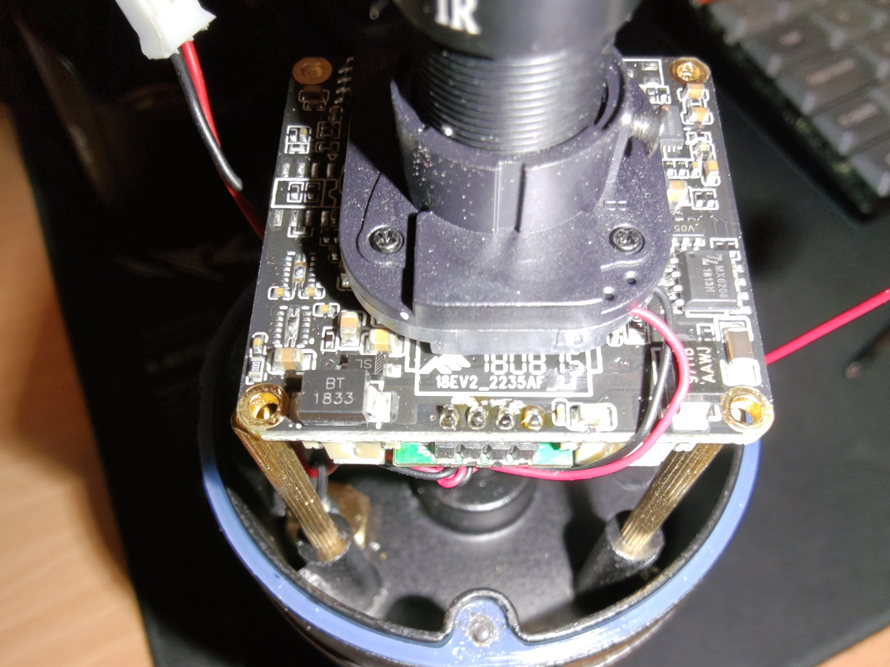

# Bedee 2 MP IP camera: hardware, firmware backup and OpenIPC

Investigating an old Bedee camera became a small firmware archaeology project: identifying the board, gaining recovery access without the stock console password, backing up the entire flash, installing OpenIPC, and restoring infrared night vision.

The result is a working **Hi3518EV200 / SC2235 camera running OpenIPC**, with Ethernet, Wi-Fi, 1080p video, a working IR-cut filter, and automatic day/night switching from the original photocell. The complete flash was backed up twice before installation. Reboot persistence, a full night/day cycle, and live video over Wi-Fi with Ethernet unplugged were verified. Later tuning raised measured video output from about **13 to 21 fps**; a wireless-only test then ran for **5 minutes 34 seconds** without a hang or reboot. Subsequent browser-navigation tests exposed another stall and full reboot. Selecting **MSE** gave smooth playback and a successful return to Dashboard, providing a workaround while the underlying fault remains unresolved.

These notes describe **one physical unit tested on 17–18 November 2026**. Wi-Fi setup and the subsequent performance investigation took place on 18 November. A Bedee badge, a similar enclosure, or a matching HTTP banner does not establish that another camera has the same board.

!!! warning "Board-specific research, not a generic upgrade recipe"
    The flash offsets, DDR configuration and register addresses below are specific to this board and the recorded image versions. Flashing replaces the stock bootloader and configuration. Make and verify a full backup, and confirm that you can access the recovery bootloader, before writing anything. The stock restoration procedure has been prepared but has **not** been tested end to end.

## Product identity and verified hardware

The stock camera reported model **`C6F0SgZ3N0P6L2`** and firmware **`V11.1.34.5.3-20180829`**. Its services exposed HiChip/Hipcam RTSP on TCP 554, Mongoose HTTP on TCP 80, and ONVIF on TCP 8080. RTSP paths `/11` and `/12` worked.

Opening the housing, reading the boot log, examining the stock dump, and booting OpenIPC identified the following hardware:

- **SoC:** HiSilicon Hi3518EV200. The package marking reads `Hi3518` / `ERBCV200`.
- **Image sensor:** SmartSens **SC2235**, confirmed by the stock software and successful OpenIPC sensor initialization.
- **RAM:** **64 MiB, DDR2**. The compared DDR initialization table includes `0x20111050 = 0x15`.
- **Flash:** **XM25QH64A**, **8 MiB SPI NOR**, reported JEDEC ID `20 70 17`.
- **PCB:** the visible silkscreen includes `18EV2_2235AF`. The complete revision suffix is not clear enough to read with confidence in the photograph.
- **Networking:** wired Ethernet and an **MT7601U** USB Wi-Fi module, USB ID **`148f:7601`**. Both worked under OpenIPC; Wi-Fi association and live video were verified after reboot and with Ethernet unplugged. The adapter supports **2.4 GHz 802.11b/g/n**, not 5 GHz.
- **Other hardware:** microSD slot, infrared LED ring with a separate visible photocell and a three-wire connection, and a mechanically actuated IR-cut filter.




The microSD controller recognized a 64 GB card during recovery. Recording, filesystem reliability and the maximum supported card capacity were not tested.

### OpenIPC support versus a vendor-compatible upgrade package

OpenIPC has a [Hi3518EV200 target](https://openipc.org/cameras/vendors/hisilicon/socs/hi3518ev200), and the inspected image contained `libsns_sc2235.so`, an SC2235 profile and loader support. Successful sensor initialization and live video confirmed that the driver worked on this unit.

[Coupler](https://github.com/OpenIPC/coupler) lists CamHi/HiChip/Xin, but that listing alone did not confirm that a suitable transition image existed for this exact Bedee model, stock firmware and board. No Coupler package was flashed or validated here. The successful route was **ROM UART recovery followed by a manually verified raw NOR image**.

OpenIPC also includes vendor components. The running streamer, Majestic, presented a licence agreement during initial setup; the owner accepted it personally and chose a new root password. Installing OpenIPC does not make every component an unrestricted open-source replacement.

## UART access

The adapter was an **FTDI TTL-232R-3V3**, identified by Linux as `0403:6001` (`FT232 Serial (UART) IC`). The working serial format was **115200 baud, 8 data bits, no parity, one stop bit, no flow control**.

For this adapter:

```text
black   -> camera ground
yellow  -> camera TX  (adapter RX)
orange  -> camera RX  (adapter TX)
red     -> DISCONNECTED
```

Power the camera from its own supply. The adapter’s “3.3 V” label refers to its UART logic levels, not its power output. Leave the adapter’s power lead disconnected.

On this board, the **second pad counting from the microSD-slot end of the four-pad row** had continuity to ground. The remaining pads all initially measured about 3.3 V, which did not identify their functions. Idle UART lines can be high. The complete pad order was not confirmed, so only the ground-pad identification is documented here.

Early serial output was unreliable. Properly soldering the wires, pads and connectors resolved the problem; the voltage readings alone had not ruled out poor connections.

To read and log the serial output on Linux:

```sh
sudo picocom -b 115200 -d 8 -p n -f n --stopbits 1 \
  --logfile camera-boot.log /dev/ttyUSB0
```

Only one program should open the serial device at a time. Stop `picocom` before using the recovery uploader. The uploader’s terminal can continue to display the Linux console after boot. The RAM upload is only needed when loading the temporary recovery bootloader.

### What the stock console revealed

The stock bootloader identified itself as:

```text
U-Boot 2010.06 (Nov 30 2017 - 15:05:15)
SPI Nor(cs 0) ID: 0x20 0x70 0x17
Block:64KB Chip:8MB Name:"xm25qh64a"
SPI Nor total size: 8MB
```

Interrupting autoboot produced a **U-Boot password prompt**. Letting Linux boot produced a separate `(none) login:` prompt. The web login did not provide access to the serial root console, and the stock shell password was not recovered. The recovery method below requires neither Telnet access nor an exploit-based shell.

## A recovery path before a flash write

[OpenIPC defib](https://github.com/OpenIPC/defib) provided recovery access over UART by using the HiSilicon ROM download protocol to load a bootloader into RAM. This session used defib revision `5167b2a8669a604ce546adb1bffc6da20cf5c1a3`.

From the private recovery kit directory on the Linux host:

```sh
sudo ../camera-recovery-env/bin/defib burn \
  --chip hi3518ev200 \
  --file recovery/u-boot-hi3518ev200-recovery.bin \
  --port /dev/ttyUSB0 \
  --break --terminal
```

Once the uploader was waiting for a device, the camera was powered on. The uploader transferred the DDR initialization data, SPL and U-Boot, then opened a console at the `OpenIPC #` prompt.

**With this command and recovery file, `burn` loaded the bootloader into RAM; it did not program the SPI flash.** Do not generalize that statement to defib's other commands. In particular, automatic installation/restoration operations have different write behavior.

The working recovery binary was 127,459 bytes and displayed **U-Boot 2010.06, built 4 October 2026**. Although both report U-Boot 2010.06, the recovery and stock bootloaders are different builds.

### Ethernet: configure it before the first network command

The lab used these private addresses:

```text
camera in recovery: 192.168.2.113
Linux TFTP host:    192.168.2.115/24 on br0
camera on Ethernet: 192.168.2.119 after DHCP
camera on Wi-Fi:    192.168.2.108 after DHCP
```

On the host, `ip -4 route get 192.168.2.113` confirmed the correct interface and source address.

In a **fresh** RAM recovery session, configure the PHY before the first `ping` or TFTP command:

```text
setenv mdio_intf rmii
setenv phyaddru 0
setenv phyaddrd 1
setenv ethaddr <YOUR-CAMERA-ETHERNET-MAC>
setenv ipaddr 192.168.2.113
setenv serverip 192.168.2.115
setenv netmask 255.255.255.0
ping 192.168.2.115
```

Replace the MAC placeholder with the unit's own wired MAC. The successful result included:

```text
eth0 : phy status change : LINK=UP : DUPLEX=FULL : SPEED=100M
host 192.168.2.115 is alive
```

An earlier attempt reported `PHY not link`. Changing settings after the driver had already registered MDIO devices produced repeated `No such device` and `PHY_PHYIDR1 read failed` messages. Starting a fresh recovery session and selecting RMII with PHY addresses 0 and 1 **before the first network operation** fixed the problem.

Read-only `mii` inspection had reported devices `'0:1'` and `'1:2'`, and a PHY with OUI `0x90c3`, model `0x05`, revision `0x04`.

!!! danger "Do not save the recovery environment over stock firmware"
    The temporary OpenIPC bootloader saves its environment at **`0x40000`**. The stock firmware's kernel starts at **`0x40000`**. Running `saveenv` while retaining stock firmware overwrites part of that kernel. All networking changes above belong in RAM only.

## Backing up the whole SPI NOR

The recovery U-Boot could read all 8 MiB and **upload** the buffer to the host over TFTP. A writable TFTP server was running on the host; an upload needs write permission and a working UDP return path, not just the ability to download files.

At the bootloader prompt:

```text
sf probe 0
mw.b 0x82000000 0xff 0x800000
sf read 0x82000000 0x0 0x800000
crc32 0x82000000 0x800000
tftp 0x82000000 bedee-stock-A.bin 0x800000
```

The CRC was **`dc96fe13`**, and the transfer reported **8.000 MB upload ok**. The entire sequence, including clearing RAM and reading flash again, was repeated to create `bedee-stock-B.bin`.

This bootloader's TFTP convention matters:

```text
tftp ADDRESS FILENAME         -> download from server into RAM
tftp ADDRESS FILENAME LENGTH  -> upload RAM to server
```

Both host files were verified independently:

```python
from pathlib import Path
import hashlib
import zlib

copies = []
for name in ("bedee-stock-A.bin", "bedee-stock-B.bin"):
    data = (Path("camera-backup") / name).read_bytes()
    copies.append(data)
    print(name, "bytes:", len(data),
          "CRC32:", f"{zlib.crc32(data) & 0xffffffff:08x}",
          "SHA256:", hashlib.sha256(data).hexdigest())
print("IDENTICAL:", copies[0] == copies[1])
```

The result for **both** files was:

```text
bytes: 8388608
CRC32: dc96fe13
SHA256: 9003857fc480dad37dfb7f44e0a02a6d389e3fd2244e3247c8458f3046c77637
IDENTICAL: True
```

These hashes identify this particular captured image. A different camera, or a later backup taken after the stock firmware has written settings, can legitimately produce different hashes.

The dump includes the bootloader, environment, kernel, filesystems and configuration. It can contain passwords and device identifiers. **The dump and the private full recovery kit are deliberately not included in this documentation repository.**

## Choosing and constructing the OpenIPC image

The tested combination was:

- **Hi3518EV200 fixed-partition NOR Lite**, firmware asset published 17 November 2026.
- **Legacy universal U-Boot**, asset published 4 October 2026, for installation in flash.
- The matching **recovery U-Boot**, for ROM/UART loading into RAM.

The firmware booted Linux **4.9.37**, identified the sensor as SC2235, and reported OpenIPC version **`master+03d1125`, `2.6.11.17-lite`**. The video preview reported **H.264, 1920×1080, 20 fps**.

### Pin the files, not the word “latest”

The upstream [firmware release](https://github.com/OpenIPC/firmware/releases/tag/latest) is mutable. The actual input file hashes were:

```text
openipc.hi3518ev200-nor-lite.tgz
  SHA256 4cb90cfef7a75468e59bd26b2e9ffeaf50e7eb1da27054890bffe124c060857a
u-boot-hi3518ev200-universal.bin
  SHA256 1eb2b173e1f655fab77ee154886acd5076bd0a2b0df2212659daba73d7b830d3
u-boot-hi3518ev200-recovery.bin
  SHA256 f39203ddd7b92f8a7e74845af7ef85417fd820caa295731eac91fa8e03d99b88
```

The downloaded assets matched the GitHub asset digests. The archive's component MD5 checks and the kernel's uImage header/data CRCs also passed. The kernel occupied **1,841,249 bytes** of its 2 MiB slot; rootfs occupied **5,070,848 bytes** of its 5 MiB slot.

The stock and universal bootloader DDR tables, byte range **`0x40..0x43f` inclusive**, were identical. The recovery and universal files decompressed to the same U-Boot payload, but their compressed payload positions differed:

```text
recovery:  0x2c00  (inside the ROM's 0x3b00 SRAM window)
universal: 0x4400  (use for flash, not the ROM UART download)
```

These files were treated as a matched set. No DDR3 bootloader, newer `2022.10` NOR bootloader, NAND image or alternative layout was substituted. Matching the DDR table provided an initial compatibility check; the successful boot later confirmed that this combination worked on the board.

### Stock layout

All offsets and lengths here are hexadecimal:

```text
name    start       length
boot    0x000000    0x040000  (stock environment at 0x030000)
kernel  0x040000    0x150000
rootfs  0x190000    0x260000
ipc     0x3f0000    0x290000
conf    0x680000    0x180000
```

### Installed OpenIPC layout

```text
name         start       length
boot         0x000000    0x040000
env          0x040000    0x010000
kernel       0x050000    0x200000
rootfs       0x250000    0x500000
rootfs_data  0x750000    0x0b0000  (704 KiB writable overlay)
```

The private candidate was assembled offline as a full **8 MiB raw NOR image**. The universal bootloader, kernel and rootfs were retained unchanged. The default bootloader environment was extended with this board's sensor, memory, networking and original MAC, serialized into a 64 KiB CRC-protected environment sector. Padding and the initial overlay were `0xff`.

The relevant board settings were:

```text
soc=hi3518ev200
sensor=sc2235
totalmem=64M
osmem=32M
mdio_intf=rmii
phyaddru=0
phyaddrd=1
netmode=eth
netaddr_fallback=192.168.2.113
```

`osmem=32M` leaves the other half of the physical RAM for the media subsystem. The release's default boot commands and helper variables were retained.

The [offline image builder](assets/bedee-openipc/assemble-image.py) reproduces this assembly process using the pinned inputs. Supply your own stock backup and the unit’s original wired Ethernet MAC. The builder performs no downloads and never contacts a camera. Keep its output outside a public repository. Its defaults reproduce the lab addresses; a different MAC or environment changes the final checksums.

```sh
python3 assemble-image.py \
  --stock /private/camera-backup/bedee-stock-A.bin \
  --firmware /private/downloads/openipc.hi3518ev200-nor-lite.tgz \
  --universal /private/downloads/u-boot-hi3518ev200-universal.bin \
  --recovery /private/downloads/u-boot-hi3518ev200-recovery.bin \
  --mac YOUR-CAMERA-ETHERNET-MAC \
  --out /private/bedee-openipc-image
```

The size and checksums of the candidate built for this unit were:

```text
full size:             8388608 bytes
full CRC32:            892a4b0a
full SHA256:           9253d8ebb644b5677a3e524bc9c7797f666af5fe27b7075ab7dc0a0a220f6e66
non-boot area CRC32:   bee8ead0  (offset 0x40000, length 0x7c0000)
```

This is a raw flash image, **not** a package for the stock web updater. The camera-specific candidate itself is not distributed here.

## The actual flash session

Before writing, the local kit verifier passed, the host route was checked, and `/dev/ttyUSB0` was available. The recovery bootloader reported 64 MiB RAM and 8 MiB NOR, and a fresh read of the entire flash still matched the stock CRC.

The host served the kit's TFTP directory. For example, with the existing `tftpy` environment:

```sh
sudo /path/to/camera-recovery-env/bin/python -u - <<'PY'
from pathlib import Path
import tftpy
tftpy.TftpServer(str(Path('tftp').resolve())).listen('192.168.2.115', 69)
PY
```

The candidate was downloaded to RAM and checked **before** erasing anything:

```text
sf probe 0
tftp 0x82000000 bedee-openipc-lite-8m-candidate.bin
printenv filesize
crc32 0x82000000 0x800000
```

The transfer contained **8,388,608 bytes**, with `filesize=800000` and CRC **`892a4b0a`**.

!!! danger "Destructive commands: historical record for the verified candidate"
    The following writes were executed on this camera. Do not paste them for a different image based only on a similar filename. Use the size and checksums calculated for the exact image in RAM, maintain stable power, and stop at any readback mismatch.

The non-boot area was written and read back first:

```text
sf erase 0x40000 0x7c0000
sf write 0x82040000 0x40000 0x7c0000
sf read 0x82040000 0x40000 0x7c0000
crc32 0x82040000 0x7c0000
```

Its CRC matched **`bee8ead0`**. Only then was the first 256 KiB replaced:

```text
sf erase 0x0 0x40000
sf write 0x82000000 0x0 0x40000
sf read 0x82000000 0x0 0x800000
crc32 0x82000000 0x800000
```

The **entire flash readback** matched **`892a4b0a`**, and only then was `reset` issued. The readback overwrote the original RAM buffer, so its CRC was compared with the expected value recorded before writing.

One mistake in the session deserves recording: `saveenv` was entered before the non-boot erase/write, and it wrote the sector at `0x40000`. The subsequent verified full candidate write replaced that sector. The final full-image CRC matched, but this mistake demonstrates why `saveenv` must not be used when preserving or restoring stock firmware.

OpenIPC booted, the owner completed first-run setup, and the board was reassembled after reconnecting the Wi-Fi antenna and IR ring. The address changed from `.113` to `.119` through DHCP. Check the DHCP lease after Linux boots rather than assuming it will use the recovery address.

The whole-image CRC will change once Linux writes to the overlay.

## A booting camera with an almost black image

There was recognizable movement, but stationary objects could become almost completely black even with the room light on and the lens uncovered. Hearing a click did not establish that the filter was in the correct position or that exposure was working correctly.

With the default slow-shutter setting, exposure reached about **125 ms**, with analog gain around **62×** and additional ISP gain. The working change was:

```yaml
isp:
  slowShutter: disabled
```

In the tested UI this was **Off · keep the frame rate**. The image returned to normal, exposure settled around **33.2 ms**, and a reboot preserved the improvement. The temporary shadow-priority exposure experiment was reverted; normal automatic metering remained enabled.

This is a verified workaround on this driver/board combination. The exact underlying long-exposure fault was not established. Changing GPIOs or repeatedly moving the IR-cut filter was not the solution to this particular darkness problem.

## Recovering the stock IR-cut and lamp wiring

The stock dump contained an ARM `ipc_server` with exported function names, plus `ircut.ko`, `rled.ko`, `light.ko`, `relay.ko` and `saradc.ko`. Static inspection of those exact files provided a better starting point than a GPIO assignment borrowed from a different camera.

### The click is an IR-cut actuator

The stock application and driver code showed how the filter was controlled:

```text
HI_IRCut_Switch(1) -> colour/day
HI_IRCut_Switch(0) -> monochrome/night

day:   ioctl 0 high -> wait 300000 us -> ioctl 0 low -> GPIO0_1
night: ioctl 1 high -> wait 300000 us -> ioctl 1 low -> GPIO0_2
```

Pulsing **global GPIO 1 moves the filter to its day position**, while pulsing **global GPIO 2 moves it to its night position**. These pins drive the IR-cut mechanism in opposite directions. The click alone did not establish that there were two relays or that the clicking mechanism supplied power to the LEDs.

The stock IR-cut module clears the low two mux bits at `0x200f0074` and `0x200f0078`; the observed values were already zero. Brief manual pulses were used during diagnosis, not sustained coil power.

The correct mapping in the tested Majestic schema was:

```yaml
nightMode:
  irCutPin1: 2  # opening/night
  irCutPin2: 1  # closing/day
```

An earlier opening/closing assignment was reversed. The recovered stock code identified the correct direction for each pin, which was then verified by testing a complete day/night cycle.

### The infrared lamp has a separate control

`HI_Infra_Switch` opens `/dev/rled`, with ioctl command 1 and argument 1 for on / 0 for off. `rled.ko` maps this to **GPIO7_7**, global **GPIO 63**, active high. Its stock mux setup sets bit 0 at `0x200f00fc`.

```yaml
nightMode:
  backlightPin: 63
  backlightInvert: false
```

The other stock modules controlled different pins: `light.ko` used GPIO 9 and 64, while `relay.ko` used GPIO 53. The module names alone did not identify these as infrared controls, so those pins were not driven during IR diagnosis.

The ring visibly glowed when shaded, even during earlier manual-mode testing. That observation did not fully explain the ring’s circuitry or prove that software could force the LEDs on in bright ambient light. The later night-vision test confirmed that the filter and illumination worked together.

## Why native automatic night mode did not return to day

The first automatic configuration used the image's exposure/gain, enabled monochrome at night, and moved the filter and lamp together. It entered night mode and produced a night-vision image. Turning the room light back on and waiting 90 seconds did **not** restore colour.

The running camera reported:

```text
isp_again                 63488   # 62 * 1024
night_auto_gain_milli      62000
night_enabled             1
night_transitions_day_total 0
```

The actual `/api/v1/config.schema.json` allowed `autoDayGain` only from **1 to 16**, with a default of 2. The lit scene was still using about **62× analog gain**. Even the highest permitted day threshold was below the gain measured in the lit room.

This build also had **no native ADC photocell configuration keys**. Generic documentation mentioning `adcReadout` did not mean the installed Hi3518EV200 binary supported it. The [Majestic documentation](https://github.com/OpenIPC/wiki/blob/master/en/majestic-streamer.md) describes several decision sources; the running binary's schema and measurements determined which were usable here.

A generic CamHi GPIO table suggested investigating GPIO 48 as a light-sensor input. Reading its entire GPIO bank at `0x201a03fc` returned zero with the photocell exposed and covered. GPIO 48 was left **unassigned and was not driven**.

## Reading the original analogue photocell

The stock application reads the photocell through **`/dev/saradc`**. Its driver module revealed the initialization and conversion sequence for an **8-bit reading from channel 0**.

OpenIPC had no `/dev/*adc*` node. Before initialization, the observed registers were:

```text
0x200f015c = 0x00000000  # mux bit already clear
0x200f0160 = 0x00000000  # mux bit already clear
0x200b0000 = 0x000080ff
0x200b0010 = 0x00000000
0x200b000c = 0x00000000
```

The stock module's open routine clears bit 0 of each mux register, writes `0xff0201ff` to `0x200b0000`, and writes 1 to `0x200b0010`. Its read ioctl writes 15 to `0x200b001c` to start a conversion, waits **10 ms** (`msleep`, confirmed by the module’s relocation entry), reads `0x200b000c`, acknowledges the conversion by writing 1 to `0x200b0018`, and returns the **low byte**.

The shell test used a longer wait of 100 ms:

```sh
# Board-specific volatile register writes, recovered from the stock driver.
# Only after verifying the mux bits above are already clear:
devmem 0x200b0000 32 0xff0201ff
devmem 0x200b0010 32 1
adc_sample() {
    devmem 0x200b001c 32 15
    sleep 0.1
    devmem 0x200b000c 32
    devmem 0x200b0018 32 1
}
```

Covering only the small photocell by hand produced fluctuating values, so the next experiment switched the room light on and off:

```text
LIGHT ON:       0 0 0 0 0 0 0 0
LIGHT OFF:    255 255 255 255 255 255 255 255
LIGHT ON AGAIN: 17 0 0 0 0 0 0 0
```

That established a usable signal and its direction: **low means bright, high means dark**. The stock configuration used hysteresis thresholds of **30 for black-and-white to colour** and **90 for colour to black-and-white**.

The old Linux 3.4 stock module was not loaded into the OpenIPC 4.9 kernel. The workaround reproduces the conversion sequence in userspace instead.

## Persistent photocell-driven day/night

The final configuration keeps Majestic responsible for the actual filter, lamp and image profile, while a small shell service decides *when* to request day or night.

```yaml
isp:
  slowShutter: disabled
nightMode:
  lightMonitor: false
  irCutPin1: 2
  irCutPin2: 1
  backlightPin: 63
  backlightInvert: false
  irCut: auto
  backlight: auto
  colorToGray: true
```

This fragment shows only the relevant settings. **Do not use it to replace the entire configuration file.** `irCut` and `backlight` follow the requested night state; `lightMonitor: false` disables the competing native decision loop.

Local API checks succeeded without putting a password in a command or script:

```sh
curl -fsS -H 'Content-Type: application/json' \
  --data '{"nightMode":{"lightMonitor":false}}' \
  http://127.0.0.1/api/v1/config
curl -fsS http://127.0.0.1/night/off  # returned 0; click and colour confirmed
curl -fsS http://127.0.0.1/night/on   # returned 1 during the night test
```

Authentication remained enabled. These requests were sent from the camera itself to its loopback address.

### Downloadable service

- [bedee-photocell.sh](assets/bedee-openipc/bedee-photocell.sh) → `/etc/bedee-photocell.sh`
- [S96bedee-photocell](assets/bedee-openipc/S96bedee-photocell) → `/etc/init.d/S96bedee-photocell`
- [Offline behavior checks](assets/bedee-openipc/test-photocell.sh), for reviewing the controller without camera access.

The controller uses the measured 0–255 range and the stock thresholds. The reading must remain **at or above 90 for 15 seconds to enter night mode**, or **at or below 30 for 60 seconds to enter day mode**. Intermediate readings reset the countdown and retain the current mode. Timing uses monotonic uptime.

It checks the ADC pin mux without changing it, saves the original ADC control values and restores them on exit, and uses a lock to prevent multiple instances from running. Mode changes use `/night/on` or `/night/off`; they do not repeatedly save YAML or write firmware partitions. If the API becomes unavailable, the controller keeps the current mode and restarts the delay when the API responds again. Failed ADC reads are retried without ending monitoring, as described below. The service still stops if native automatic switching is enabled or its decision source is unknown.

The installed file hashes were:

```text
bedee-photocell.sh
  b342a93d8892dff9f6aa0090fb52b32bcf81be1bf72cd4e4d04c201c3d13b252
S96bedee-photocell
  71cf9495464550e6be177ea83d0dc6dff92a7d53b80bb7ccb9888e508f351c58
```

These hashes identify the versions installed during the initial hardware tests. The revised init script polls for a verified controller PID for up to ten seconds and reports early exits or a startup timeout. After offline checks passed, that revision was deployed and verified through another camera reboot, as described below.

For a clean installation, copy the two files to `/tmp` on the camera first. Keep Unix LF line endings; the companion directory's Git attributes enforce them on checkout. Legacy `scp -O` can be needed when the camera has no SFTP subsystem. Stop any temporary test loop, apply the settings above, and inspect the files before installing:

```sh
(
    set -e
    sh -n /tmp/bedee-photocell.sh
    sh -n /tmp/S96bedee-photocell
    test ! -e /etc/bedee-photocell.sh
    test ! -e /etc/init.d/S96bedee-photocell
    test ! -e /etc/bedee-photocell.disabled
    cp /tmp/bedee-photocell.sh /etc/bedee-photocell.sh
    cp /tmp/S96bedee-photocell /etc/init.d/S96bedee-photocell
    chmod 755 /etc/bedee-photocell.sh /etc/init.d/S96bedee-photocell
    /etc/init.d/S96bedee-photocell start
    /etc/init.d/S96bedee-photocell status
    sync
)
```

The existing boot sequence executes `S??*` scripts in order, so S96 runs after S95majestic. The controller may start before Majestic’s API is ready; it waits until the API responds.

!!! note "The WebUI reports the native decision source as manual"
    `night_mode_source` remains **0** because the external photocell service makes the decisions. Automatic behavior is still active. Leave the WebUI's gain-based automatic monitor **off** while this service runs.

### Verification and service controls

Eleven regression scenarios passed: day/night delays, a brief shadow, hysteresis resetting the timer, API outage recovery, a rejected request, a competing automatic source, persistent ADC failure, transient ADC failures resetting each switching delay, and recovery after an ADC outage. These tests simulated the hardware, API responses and elapsed time. All eleven also passed in an isolated fixture under the camera's BusyBox shell, with the hardware and API functions replaced by mocks. Actual light switching was tested separately.

On the camera, both files passed shell syntax and SHA256 checks. After a normal reboot, their hashes were unchanged and the service started automatically. Its log showed the initial API outage and recovery, then a night request at **ADC 255**. Metrics showed night, IR-cut and lamp all enabled. After turning the light on, the owner confirmed normal colour and metrics showed all three disabled. Both physical transitions were verified after reboot.

The revised init script was subsequently installed on **18 November 2026**. The upload and staged file passed shell syntax and SHA256 checks before the installed script was replaced with an atomic rename and permissions **`0755`**. The original was retained at `/etc/S96bedee-photocell.before-readiness-fix`. The revised init script's SHA256 is:

```text
8657ac6479f6d1f02639765008a881a1a88e768b374666e8be1726678cfef115
```

A changed kernel boot ID confirmed the subsequent reboot. Wi-Fi returned at `192.168.2.105`, and the installed script retained its hash and executable permissions. The photocell controller started automatically as **PID 1038**, without a manual service start. Its logs showed the expected thresholds and delays, a brief wait for Majestic's API, and recovery when the API became available. A later status check confirmed that the same controller process was still running. Day-mode metrics reported night mode, IR-cut and lamp all disabled. This deployment check did **not** repeat the physical light-cycle test performed with the earlier revision.

Useful checks:

```sh
/etc/init.d/S96bedee-photocell status
logread | grep bedee-photocell
curl -fsS http://127.0.0.1/metrics/night
```

To disable automatic switching and leave the camera in day mode:

```sh
/etc/init.d/S96bedee-photocell stop
touch /etc/bedee-photocell.disabled
curl -fsS http://127.0.0.1/night/off
```

Remove `/etc/bedee-photocell.disabled` and start the service to re-enable it. Both scripts and the disable marker are stored in the writable overlay. A full reflash or overlay reset requires reinstalling the service and reapplying the exposure and pin settings; the original flashed candidate did not contain these later fixes.

### Recovering from intermittent ADC read failures

A later status check found that the original controller had exited after logging `ADC read failed; stopping without switching.` A single failed conversion could therefore leave automatic day/night switching stopped until the service was restarted. The underlying cause of that occasional read failure was not established.

The revised controller tries each reading up to **three times**, with a one-second pause between failed attempts. Any failed read clears the pending day/night countdown. If all three attempts fail, the controller **retains the current mode, waits five seconds, and tries again**. It emits periodic warnings during a sustained fault and logs recovery when valid readings resume. Switching then requires a fresh, uninterrupted interval of valid readings; an ADC outage cannot count toward the 15-second night or 60-second day delay. A persistent hardware fault still prevents reliable light measurement, but no longer makes this error path terminate the process.

The revised controller was hash-checked, installed with an atomic rename and permissions `0755`, and started through the existing init script. The previous controller was retained at `/etc/bedee-photocell.before-adc-retry.sh`. The revised `bedee-photocell.sh` SHA256 is:

```text
7e2b6f92ca7ce6c6c415b1b1b2649427025cd42abf2f3103e7852a0e325179c6
```

With this revision running, the owner turned the room light off and on. Logs recorded an accepted night request at **ADC 255**, followed by an accepted day request at **ADC 0** after the bright-light delay. Metrics confirmed the corresponding night-mode, IR-cut and lamp states, and the same controller process remained running throughout. ADC failures and recovery were injected only in the mocked tests; the real light-cycle check did not deliberately disturb ADC hardware.

A subsequent intentional reboot confirmed automatic startup of this ADC-retry revision, with no manual service start. Both controller and init-script hashes matched, the controller remained running through the check, and the logs showed recovery from the initial API outage without a new ADC error. The saved `video0.fps=30`, `isp.blkCnt=5` and `isp.slowShutter=disabled` settings persisted; runtime tables confirmed VPSS **30 → 30** and four YUV buffers plus one raw buffer. Encoded-frame counter deltas measured approximately **20.5 fps** after reboot.

## Enabling Wi-Fi

Wi-Fi was investigated after the wired camera and automatic night mode were working. Ethernet remained connected during setup so a failed wireless connection would not interrupt access to the camera.

### The adapter was present, but its driver was not loaded

The initial checks showed USB device **`148f:7601`**, but no `wlan0` interface and no driver bound to the USB device. The bootloader environment had **no `wlandev` value** and retained **`netmode=eth`**. The Network page showed **None — wired Ethernet only** as the adapter selection.

The driver was already included in the installed image:

```text
/lib/modules/4.9.37/kernel/drivers/net/wireless/mediatek/mt7601u/mt7601u.ko
```

Useful diagnostic commands, run on the OpenIPC camera, were:

```sh
lsusb
ip link show
fw_printenv wlandev netmode
find /lib/modules -iname '*7601*'
```

The BusyBox version of `ip` did not support `ip -br link`; `ip link show` worked. An unset `wlandev` produced an environment-variable error, but the USB device and driver file were both present.

Loading the driver manually created `wlan0`:

```sh
modprobe mt7601u
ip link show wlan0
dmesg | grep -Ei 'mt7601|mt76|wlan|firmware'
```

The driver initialized successfully and reported:

```text
ASIC revision: 76010001 MAC revision: 76010500
Firmware Version: 0.1.00 Build: 7640 Build time: 201302052146____
EEPROM ver:0c fae:00
Selected rate control algorithm 'minstrel_ht'
usbcore: registered new interface driver mt7601u
```

No extra GPIO power control was needed. The adapter already enumerated on USB, and the generic driver initialized it without changing any GPIOs.

### Selecting the adapter and fitting the antenna

In **System → Network → Wireless adapter**, the working selection was **`mt7601u-generic — no pad`**, followed by **Save radio**. Reading back the relevant environment values confirmed:

```text
wlandev=mt7601u-generic
netmode=eth
```

The Ethernet fallback address remained `192.168.2.113`. The board-specific alternatives which toggle a power GPIO were unnecessary for this unit.

The setting was saved immediately. The UI's restart notice meant that the driver selection would be applied during the next boot; rebooting was not required to save it. The manually loaded driver allowed testing to continue in the current session.

The first scans found no networks. The owner then noticed that the **Wi-Fi antenna was missing**. The wireless interface was taken down while the antenna was fitted, leaving Ethernet available:

```sh
ip link set wlan0 down
```

After fitting the antenna, another scan found **six networks**, including two with strong signals around **−21 and −23 dBm**. The empty scan before fitting the antenna was therefore not sufficient evidence of a driver or radio fault.

The [Linux Wireless documentation](https://wireless.docs.kernel.org/en/latest/en/users/drivers/mediatek.html) identifies MT7601U as a **2.4 GHz 802.11b/g/n** device. Select a network available on that band; a 5 GHz-only network is not suitable. The networks found in this test advertised WPA2. Other security modes were not tested.

### Saving the network credentials

In **System → Network → Wi-Fi**, the owner selected the intended network from the scan results, entered the password directly in the camera's form, left the IP setting on **Automatic**, and clicked **Save Changes**. The password was not shared in chat or copied into these notes, scripts or the repository.

The camera associated with the access point on **channel 13, 2.472 GHz**. The first successful link check reported **−24 dBm** signal strength and **70/70** link quality. A ping explicitly bound to Wi-Fi reached the router:

```sh
iwconfig wlan0
ip -4 addr show wlan0
ip -4 route show
ping -I wlan0 -c 3 -W 2 192.168.2.1
```

All three packets received replies, with **0% packet loss** and round-trip times of roughly **2–4 ms**. Binding the test to `wlan0` established that it was using Wi-Fi even while Ethernet was still connected.

During application of the settings, `wlan0` briefly showed `192.168.2.113`; DHCP subsequently assigned **`192.168.2.108`**. The Ethernet interface remained at **`192.168.2.119`**. Check the current interface address or router lease rather than assuming that the recovery or fallback address is the Wi-Fi address.

### A misleading `wpa_cli` error

`wpa_cli` and `wpa_supplicant` were both installed. `iwlist` was also present as a symlink to `iwconfig`. The WebUI's scan handler brings the interface up, tries `wpa_cli scan` and `scan_results`, and falls back to `iwlist` if necessary.

Before configuration, `wpa_cli -i wlan0 status` reported:

```text
Failed to connect to non-global ctrl_ifname: wlan0 error: No such file or directory
```

The same error remained after association because the generated WPA configuration had **no `ctrl_interface` entry**. The absence of a control socket prevented this diagnostic command from working; it did not mean that the camera had failed to connect. The link state, Wi-Fi address and interface-bound ping confirmed a working connection.

When collecting diagnostics, use narrowly scoped reads such as `fw_printenv wlandev netmode`. A complete environment dump or generated WPA configuration can expose the saved password. Checking only for a `ctrl_interface` entry does not require printing the rest of that file.

### Reboot and Ethernet-unplug tests

After saving the adapter and credentials, the camera was rebooted once. Without another manual `modprobe` or credential entry, it loaded the driver, associated with the access point, and obtained **`192.168.2.108/24`** again. Another Wi-Fi-bound router ping returned three replies with no packet loss. The photocell service also started automatically and remained running.

With both interfaces connected, the routing table preferred Ethernet; the Wi-Fi routes had **metric 10**. Keeping `netmode=eth` did not disable Wi-Fi. The existing `S40network` script manages Ethernet alongside the wireless connection and removes the Ethernet routes when the cable is unplugged.

The owner then signed in to the live view at the Wi-Fi address and unplugged **only the Ethernet cable**, leaving the camera powered. Video continued. A separate console session through the Wi-Fi address confirmed the following results; device identifiers have been omitted:

```text
Ethernet carrier: 0
wlan0: UP, LOWER_UP
IPv4 address: 192.168.2.108/24
default via 192.168.2.1 dev wlan0 metric 10
192.168.2.0/24 dev wlan0 scope link src 192.168.2.108 metric 10
Bit Rate=28.9 Mb/s
Link Quality=70/70  Signal level=-22 dBm
3 packets transmitted, 3 packets received, 0% packet loss
round-trip min/avg/max = 2.507/3.233/3.945 ms
Photocell controller running
```

Only Wi-Fi routes remained, so the continued video and console access did not depend on Ethernet. The camera's current wireless live-view address was `http://192.168.2.108/cgi-bin/live.cgi`; future DHCP leases may differ.

The reported **28.9 Mb/s is a PHY link rate**, not a throughput measurement. The wireless live view was **H.264 at 1920×1080**, with WebRTC reporting **13 fps** during this initial test. The later investigation below measured the encoder directly, improved frame delivery, and tested wireless throughput separately.

## Investigating low frame rate and apparent Wi-Fi hangs

After Wi-Fi was enabled, the owner reported a lower frame rate, a sluggish WebUI, and eventually a camera which appeared unresponsive. Reconnecting Ethernet provided a recovery path, although HTTP sometimes accepted a TCP connection without returning any headers. SSH remained accessible during part of the incident.

The camera did reboot: two metric snapshots had boot times **333 seconds apart**, and an SSH uptime check confirmed a recent system start. Majestic reported a **300-second watchdog**, fed every 150 seconds. That timing was consistent with a watchdog reset, but did not establish what stopped the service from responding. The available logs contained no matching out-of-memory or crash report, and `/etc/crash` was empty. The cause of those earlier hangs remains unresolved.

The owner installed an SSH public key for subsequent diagnostics. Passwords and private keys were not copied into these notes. Narrowly scoped SSH reads avoided relying on the WebUI's console while its service was stalled.

### Separating frame production from network throughput

With no browser viewers, deltas of `venc0_encoded_frames_total` in `/metrics` measured approximately **13.3 fps**. The saved video rate was initially automatic (`video0.fps=0`), which selected 20 fps on this configuration. Explicitly setting 20 did not improve delivery. Taking Wi-Fi down and unloading its driver also left the encoder at approximately **13.4 fps**.

This established that the low frame rate existed before network transmission. It did not rule out an additional wireless problem or explain the reboots.

Useful read-only diagnostics were:

```sh
cat /proc/umap/vi
cat /proc/umap/vpss
cat /proc/umap/venc
cat /proc/umap/vb
cat /proc/media-mem
curl -fsS http://127.0.0.1/metrics
```

On this build, media-memory allocation was available at **`/proc/media-mem`**; `/proc/umap/mmz` did not exist. Restrict any metrics or log excerpts before publishing them, since they can include device or network identifiers.

The encoder reported no overload or full-buffer errors. Capture did report buffer failures: one snapshot showed **2,267 `VbFail` events from 9,090 interrupts**. More importantly, the video-processing subsystem (VPSS) exposed another discard step:

```text
VI channel output:             about 20 fps
VPSS channel SrcFRate:         30
VPSS channel DstFRate:         20
VPSS/VENC delivered output:    about 13 fps
```

VPSS was keeping only two out of every three incoming frames even though capture was already delivering about 20. The source/destination fields in the VENC table were both `-1`; the decisive rate-control values were in **the VPSS table**, not the encoder table.

### Removing the extra discard and adding buffer headroom

Setting the requested video rate to 30 changed VPSS to **30 → 30**, removing that additional discard:

```sh
cli -s .video0.fps 30
```

Measured output rose to approximately **19.5 fps**. This setting did not make the camera capture 30 frames per second; it allowed more of the frames it was already producing to reach the encoder.

The board splits its 64 MiB RAM into **32 MiB for Linux and 32 MiB for media buffers**. Before the buffer experiment, the media allocator had **8,076 KiB free**. Its common pools held three 3,110,400-byte YUV frames and one 4,147,200-byte raw frame. Majestic described this as four automatic blocks.

The pool was increased by one block:

```sh
cli -s .isp.blkCnt 5
```

The common YUV pool then held four frames alongside the raw frame. Media-memory use rose to **27,728 KiB**, leaving **5,040 KiB free**. Measured output reached approximately **21 fps**. Capture failures decreased but remained present: a later interval recorded 120 failures from 562 interrupts. The change improved delivery without eliminating every capture loss.

The final saved settings were read back and flushed with `sync`:

```yaml
video0:
  fps: 30
isp:
  blkCnt: 5
  slowShutter: disabled
```

This is an excerpt of the relevant settings, **not a replacement configuration file**. The earlier slow-shutter workaround remained in place. A subsequent reboot after installing the revised photocell init script confirmed that all three settings persisted. Runtime tables also showed **VPSS 30 → 30**, four common YUV buffers and one raw buffer, with **5,040 KiB** of media memory still free.

After that reboot, the encoded-frame counter advanced from **1,533 to 1,746** over **10.51 seconds**, measuring approximately **20.3 fps** with no WebRTC viewer connected. This confirmed continued frame production after reboot; it was a short measurement, separate from the longer wireless live-view test below.

To undo only the buffer override, use `cli -d .isp.blkCnt`. To restore the original automatic rate selection, use `cli -s .video0.fps 0`; on this tested configuration that selected 20 and produced the extra VPSS discard again.

### Measuring the wireless path

Restoring the existing `mt7601u` driver briefly caused USB disconnects, re-enumeration and two probe failures with error `-5` before the adapter associated successfully. An initial `ifup wlan0` ran before the device was ready; a later attempt worked. These events occurred during driver reload and do not prove that USB faults caused the earlier spontaneous hangs. Avoid repeated driver unloading and reloading as a routine fix.

DHCP now assigned **`192.168.2.105`** to Wi-Fi. Power management was already **off** after association, with signal strength around **−47 to −51 dBm**.

A temporary receiver on the local computer accepted identical **1 MiB dummy uploads**, with the camera's `curl` explicitly bound to `eth0` or `wlan0`. Client-reported upload rates were approximately **75.8 Mb/s over Ethernet** and **14.3 Mb/s over Wi-Fi**. The wireless gateway ping returned all three packets with an average round-trip time of **2.2 ms**. These were short throughput tests, not sustained capacity measurements.

OpenIPC's [Wi-Fi driver notes](https://github.com/OpenIPC/wiki/blob/master/en/adding-wifi-driver.md) describe poor upload performance with mainline `mt7601u` on another Hi3518EV200 camera, and improved results with the alternative `mt7601sta` driver. This unit's short upload test did not reproduce that throughput limit. No alternative driver was installed, and no firmware change was made during the performance investigation.

Opening the page at the wireless address was **not sufficient proof that WebRTC video used Wi-Fi**. With Ethernet connected, interface counters showed the video traffic leaving through `eth0` while almost no data left through `wlan0`. WebRTC had selected the wired path even though the page was opened at the wireless address.

The owner therefore unplugged only Ethernet, leaving power connected. SSH monitoring continued through the wireless address. Across **32 samples spanning 333.58 seconds**, the single live WebRTC viewer produced:

- **21.01 fps** at 1920×1080, measured from encoded-frame counter deltas.
- **1.70 Mb/s** of encoded video; Wi-Fi transmitted **1.885 Mb/s** including overhead.
- **Zero Ethernet transmit bytes**, confirming the wireless path.
- At least **10.23 MiB of available Linux memory**.
- Unchanged system and application boot counters, and no new USB error messages.

The owner also reported noticeably less video delay. This was a successful **5½-minute wireless-only run**, not proof of long-term reliability or a demonstrated fix for the earlier hangs. If another stall occurs, reconnect Ethernet and collect logs before rebooting, since a reset can discard the evidence.

### Practical frame-rate limit

Approximately **20–21 fps at 1080p** is the best measured result from this session. Neither the requested 30 fps nor the SC2235's nominal mode establishes that this complete board can sustain 30 fps through capture, processing and encoding. Capture still reported losses, and the absolute hardware limit was not established.

A longer stability run is the next useful check. Lower-resolution video, such as 720p at 25–30 fps, remains a possible experiment; that mode and those rates were **not tested** on this unit.

## Investigating Live and Dashboard reboots

Later on **18 November 2026**, the owner reported that live view had run overnight, but switching to Dashboard caused a long delay. When the page returned, it showed **system uptime of five minutes and Majestic uptime of four minutes**. A changed kernel boot ID confirmed a full camera reboot. This was more than a dashboard page or streamer restart.

### Capture evidence before another reset

Ethernet was connected for recovery, and logs were streamed to the local computer before trying another transition. The following reads help distinguish a process restart from a system reboot:

```sh
cat /proc/sys/kernel/random/boot_id
cat /proc/uptime
uptime
/etc/init.d/S96bedee-photocell status
```

To preserve logs across a camera reboot, run this on the host rather than saving the only copy in the camera's RAM:

```sh
ssh root@192.168.2.119 'logread -f' > camera-live.log
```

Keep that log private until network identifiers and other personal details have been removed. An SSH timeout alone does not establish that the whole system has frozen: one diagnostic connection also timed out while other camera requests remained responsive. Comparing boot IDs provided the stronger evidence here.

During the controlled attempt, the owner encountered heavy lag while **opening Live**, before completing the intended return to Dashboard. The off-camera log recorded a native WebRTC session opening, followed about twelve seconds later by API unavailability and an encoder warning reporting **1.489 fps**. HTTP stopped responding, and new SSH connections on both the wired and wireless addresses stalled before receiving the server banner.

The owner closed the camera tabs to prevent automatic reconnection. The camera later returned with another changed boot ID and **18 seconds uptime**, without a requested reboot or power-cycle. The configured 300-second watchdog was a plausible recovery mechanism, but no direct reset-cause report established that. No out-of-memory or panic message was captured, and no complete thread dump from the stalled interval was obtained. The sequence narrows the investigation; it does not establish the exact backend defect.

### Separate slow page generation from a snapshot failure

The dashboard's JavaScript requests `/image.jpg` every five seconds. Installed dashboard file hashes matched the inspected release files, and the log showed JPEG snapshots being served normally before the stall. An isolated local JPEG request after recovery returned **HTTP 200 in approximately 0.26 seconds**.

An isolated Dashboard HTML request returned HTTP 200 headers but reached a five-second client timeout after receiving only part of the page. This exposed a separate page-generation delay without reproducing the reboot. Neither observation proved that the JPEG encoder or Dashboard alone caused the system failure.

### Use MSE as the current workaround

With previous camera tabs closed, the owner opened Live and selected **MSE**. Playback was reported as smooth. Switching from that MSE view to **Dashboard** then loaded normally, while monitoring showed unchanged system and application boot identifiers and the same Majestic process.

On this build, **MSE can still use WebRTC underneath**. Metrics and logs confirmed a DTLS/SCTP data channel carrying the video during this test. Selecting MSE therefore bypassed native WebRTC RTP video; it did not disable every WebRTC component. The earlier successful wireless live-view test also shows that native WebRTC was not consistently failing. These observations implicate the native video path or its transitions, without proving which part is faulty.

For this unit, keep **MSE** selected in Live and use one camera tab while investigating. The WebUI stores the playback selection in the browser's local storage, so another browser profile or clearing site data can require selecting it again. This workaround required no firmware, driver or camera-configuration change.

CPU use was high during an MSE playback sample, but HTTP and SSH remained responsive and available Linux memory stayed around **10–11 MiB**. After the successful Dashboard transition, encoded-frame deltas still measured approximately **20.9 fps**, and the photocell controller was running. These healthy-interval measurements do not rule out a different resource failure during the earlier stall.

The MSE comparison was a short controlled test, not another overnight reliability test or a permanent fix. If the problem returns, preserve logs off the camera, record the boot ID, and collect evidence before rebooting.

## Returning to the stock firmware

Use the original full flash dump to restore the stock firmware. Load the temporary bootloader again through **ROM UART recovery**, which does not depend on the installed Linux system or the bootloader’s console password. Configure RMII and PHY addresses before network access, then download the private stock image:

```text
sf probe 0
tftp 0x82000000 bedee-stock-8m.bin
printenv filesize
crc32 0x82000000 0x800000
```

For **this recorded backup**, confirm a transfer size of 8,388,608 bytes and CRC **`dc96fe13`** before erasing flash. Use your independently verified values for a different backup.

!!! danger "Prepared restoration procedure — not hardware-tested end to end"
    The following would replace the entire installed system. The ROM recovery, flash reads, Ethernet transfer, and OpenIPC flash-write path worked. A complete stock restore and subsequent stock boot were not performed. Do not present that untested final step as a guaranteed recovery.

Restore the non-boot area first:

```text
sf erase 0x40000 0x7c0000
sf write 0x82040000 0x40000 0x7c0000
sf read 0x82040000 0x40000 0x7c0000
crc32 0x82040000 0x7c0000
```

The stock non-boot CRC must be **`28b590ad`**. Only after that matches, restore the original boot region and its environment:

```text
sf erase 0x0 0x40000
sf write 0x82000000 0x0 0x40000
sf read 0x82000000 0x0 0x800000
crc32 0x82000000 0x800000
```

Require full readback CRC **`dc96fe13`**. You can also upload the full readback over TFTP and compare its SHA256 with the original backup on the host before resetting. **Do not run `saveenv` after restoring stock**: the temporary bootloader would overwrite the restored kernel at `0x40000`. The original bootloader reads its own environment at `0x30000` after reset.

If the ROM recovery path cannot be re-established, an appropriate **3.3 V SPI programmer** is the remaining hardware fallback. No external SPI programmer was needed or tested in this session. Check the board’s power connections and whether the flash chip needs to be isolated from the rest of the circuit before connecting a programmer.

## What is verified, and what is still open

Verified on this physical camera:

- Serial communication and a working ROM-to-RAM recovery route.
- Two independent, byte-identical full flash backups, with matching target and host CRCs.
- Ethernet/TFTP in recovery and Ethernet networking under OpenIPC.
- MT7601U Wi-Fi scanning and association, automatic connection after reboot, and live video with Ethernet unplugged.
- Frame-rate and buffer tuning from roughly 13.3 to 21 fps, followed by a 5½-minute wireless-only live-view test with stable memory and no new USB errors or reboot.
- The complete OpenIPC flash write and full-image readback, followed by a successful boot.
- SC2235 1080p video, the slow-shutter workaround, IR-cut direction, night vision and return to colour.
- Photocell-driven automatic operation and service startup after reboot.
- Deployment and automatic startup of the revised photocell init script after reboot, with the final frame-rate, buffer and slow-shutter settings retained and approximately 20.3 fps measured afterward.
- Automatic startup of the ADC-retry controller after a subsequent reboot, with the same video settings retained and approximately 20.5 fps measured afterward.
- A later full-camera reboot during browser testing, followed by smooth MSE playback and a successful MSE-to-Dashboard transition without another restart in that controlled comparison.

Still unverified or incomplete:

- An end-to-end restoration and boot of the saved stock image.
- Audio, recording, buttons, and any motor/PTZ functions under OpenIPC.
- Exact PCB revision suffix, a complete four-pad UART pinout, and the full schematic of the IR ring.
- A vendor-web-updater/Coupler transition for this exact model.
- Long-term stability, outdoor switching thresholds, and behavior under unusual IR reflections or changing ambient lighting.
- The underlying cause of the hangs and browser-associated reboots, long-term reliability of the MSE workaround, and sustained wireless throughput beyond the short upload and live-view tests.
- The maximum reliable frame rate and higher-rate 720p modes.

## References and evidence

The board photographs, boot logs, two matching backups, extracted stock modules, release hashes, actual camera schema, reboot/light-cycle tests, and Wi-Fi tests with Ethernet unplugged are the primary evidence for this unit. Private dumps, credentials, camera-specific environment files and raw flash images are intentionally excluded.

- [OpenIPC Hi3518EV200 target](https://openipc.org/cameras/vendors/hisilicon/socs/hi3518ev200)
- [OpenIPC firmware releases](https://github.com/OpenIPC/firmware/releases/tag/latest)
- [OpenIPC legacy bootloader source](https://github.com/OpenIPC/u-boot-hi3516cv200/tree/f769967e4dd56e727ee948e6102ac7544d722460)
- [OpenIPC defib](https://github.com/OpenIPC/defib)
- [OpenIPC Coupler](https://github.com/OpenIPC/coupler)
- [Supported sensor drivers](https://github.com/OpenIPC/wiki/blob/master/en/guide-supported-sensors.md)
- [Majestic configuration](https://github.com/OpenIPC/wiki/blob/master/en/majestic-config.md) and [streamer documentation](https://github.com/OpenIPC/wiki/blob/master/en/majestic-streamer.md)
- [Linux Wireless: MediaTek drivers and supported bands](https://wireless.docs.kernel.org/en/latest/en/users/drivers/mediatek.html)
- [OpenIPC Wi-Fi driver notes](https://github.com/OpenIPC/wiki/blob/master/en/adding-wifi-driver.md)
- [OpenIPC media-memory and buffer tuning](https://github.com/OpenIPC/wiki/blob/master/en/memory-tuning.md)
